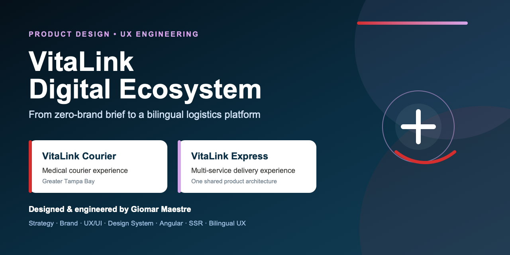

# VitaLink Digital Ecosystem

Client-authorized portfolio edition of the bilingual VitaLink Couriers website and VitaLink Express service experience.

The project connects product strategy, brand creation, service architecture, UX/UI design, reusable Figma components, Angular engineering, server-side rendering, localization, Git-based delivery, and managed cloud deployment.

## Portfolio review



Choose the review path that matches your focus:

- [Product and UX case study — English](./docs/case-study.en.md)
- [Caso de producto y UX — Español](./docs/case-study.es.md)
- [Technical architecture](./docs/architecture.md)
- [Evidence and claim register](./docs/evidence-register.md)
- [Public documentation index](./docs/README.md)

## Product surfaces

- **VitaLink Courier:** medical courier and healthcare-logistics information for Greater Tampa Bay.
- **VitaLink Express:** same-day, regional, specialized cargo, document, and e-commerce delivery information.
- **Quote intake:** local validation followed by an explicit WhatsApp or SMS handoff. The current repository does not transmit form data to a backend.

Production references:

- <https://www.vitalinkcouriers.com/>
- <https://express.vitalinkcouriers.com/express>

Design reference:

- [VitaLink Figma file](https://www.figma.com/design/ORBLgTs7eKP0TwfxmIa1uC/VitaLink?node-id=2-3)

## Authorship

Giomar Maestre led the project from its zero-brand starting point through research, product and content strategy, information architecture, visual identity, UX/UI, component design, technical decisions, frontend implementation, repository delivery, and deployment coordination.

VitaLink Couriers owns the business, operational expertise, service offering, and approved brand implementation. This portfolio edition uses a curated public history; the isolated source history remains private for attribution evidence.

Builder.io, Claude, Codex, and related tools assisted selected exploration, documentation, and implementation activities under Giomar Maestre's direction and review.

## Current technology

- Angular 22 standalone components
- TypeScript 6 in strict mode
- RxJS 7
- Tailwind CSS 3
- Angular SSR and route prerendering
- Node.js and Express SSR host
- Custom JSON-based English and Spanish localization
- Jasmine and Karma tests
- Docker deployment configuration

This repository does not currently claim verified Lighthouse scores, complete WCAG conformance, PWA support, production form delivery, real-time tracking, payments, analytics, CI/CD, or third-party operational integrations.

## Routes

### VitaLink Courier

- `/`
- `/about`
- `/services`
- `/sam-gov`
- `/certifications`
- `/faq`
- `/contact`

### VitaLink Express

- `/express`
- `/express/services`
- `/express/services/:service`
- `/express/codes-certs`
- `/express/contact`
- `/express/sectors/:sector`

Known static pages are prerendered. Parameterized service and sector pages use server rendering. Unknown routes return an HTTP 404 response.

## Local development

### Requirements

- Node.js 22.22.3 LTS
- npm compatible with the committed lockfile
- Google Chrome or Chromium for the Karma test runner

### Install and run

```bash
npm ci
npm start
```

Open <http://localhost:4200/> for the main experience or <http://localhost:4200/express> for Express.

### Validation

```bash
npm run test:ci
npm run build
npm run serve:ssr:vitalink-digital-ecosystem
```

The SSR server defaults to <http://localhost:4000/>. Set `PORT` to override it.

## Architecture

```text
src/app/
├── components/       Shared navigation, footer, and modal UI
├── guards/           Host-aware Express entry routing
├── pages/            Main and Express route surfaces
├── pipes/            Translation pipe
├── services/         Localization, site detection, SEO, and messaging
├── app.routes.ts     Browser routes and route-level SEO metadata
└── app.routes.server.ts
                      SSR, prerender, and HTTP status strategy
```

Translation resources live in `src/assets/i18n/`. English and Spanish currently contain the same number of leaf values; parity of key structure is validated separately from translation quality and responsive fit.

## Portfolio publication boundaries

This edition contains only the approved application source, curated documentation, local brand assets, and automated tests required to review the work. Client repository metadata, production infrastructure, private working files, and non-public design material are excluded from the public snapshot.

## Current limitations

- Quote-form values are validated locally and are not sent to a backend.
- Automated tests cover critical configuration and interaction behavior but are not a comprehensive application test suite.
- Accessibility, performance, responsive behavior, and external links require final portfolio QA before publication.
- Approved brand assets are stored locally in this edition; final browser UAT and Figma evidence capture remain publication-gate work.

## License and permitted use

This is a client-authorized, source-available portfolio edition. It is not an open-source distribution. See [LICENSE-NOTICE.md](./LICENSE-NOTICE.md).
